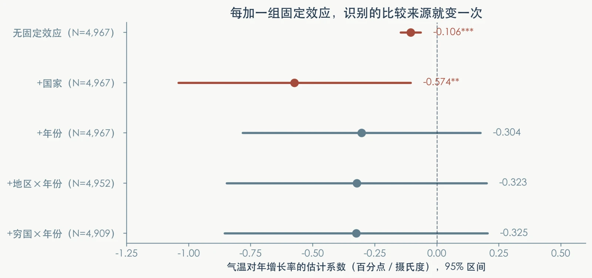
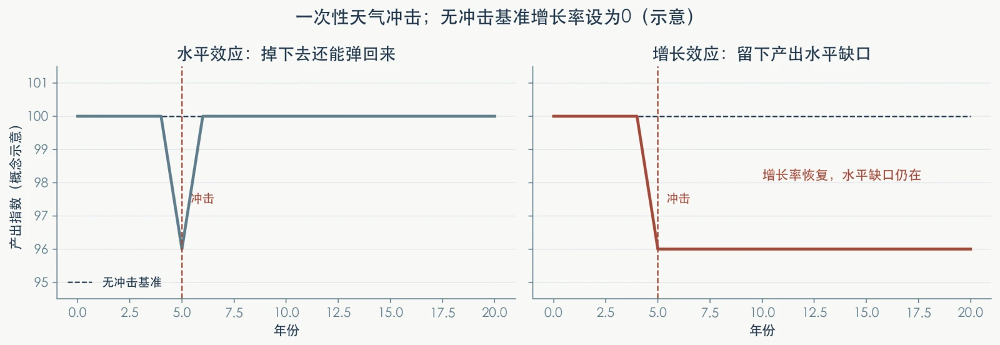

# 第6讲：面板数据（二）

> 本页是第六讲的完整网页讲义。课堂课件保持三个部分；详细复现操作放在[案例实操](https://zhang-chenglei.github.io/Econometrics-course/course/lesson6_lab.html)，参考代码与数值放在[代码和结果分析](https://zhang-chenglei.github.io/Econometrics-course/course/lesson6_code.html)。

## 本讲指南

### 这一讲讲什么

上一讲把比较从“不同企业之间”转向“同一家企业内部”，排除了长期不变的干扰。本讲继续追问：真实研究中，还需要吸收哪些共同冲击？误差相关时，我们有多确定估出的数字？异质性、趋势与滞后又各自在回答什么问题？

主线案例是 Dell, Jones & Olken (2012) 的温度冲击与经济增长研究。这里使用的是作者公开的真实国家—年份数据，区别于第五讲的教学模拟样本。

### 这一讲怎么安排

1. **固定效应加到什么程度才够？** 从国家固定效应，到年份、地区×年份和穷国×年份共同冲击，逐层说明比较来源。
2. **标准误为什么不能随便算？** 区分估计与推断，从序列相关到国家聚类与双向聚类。
3. **真实面板模型还会怎样扩展？** 用交互项研究异质性，用国家趋势与分布滞后追问趋势和动态问题。

> 选择比较 → 判断不确定性 → 用经济问题扩展模型。

复现是课后的拓展练习，不作为第四个正文部分。先理解三个问题，再使用案例包检查自己的判断。

### 本讲目标

学完本讲，你应当能够：

- 说明国家、年份和交叉固定效应各自吸收什么，并识别过度吸收；
- 根据误差相关结构说明聚类层级，区分固定效应与聚类标准误；
- 区分组间差异、穷国额外效应与穷国总效应；
- 解释国家趋势和滞后结构改变了什么问题、用了什么信息；
- 对照样本量、系数、标准误与 p 值，说明教学估计与论文原包的差异。

### 达成效果

形成一张模型对照表、一段结果解释、一份可运行代码和一次人工核验记录。解释中回答：比较谁与谁？吸收哪些冲击？误差在哪一层相关？结论的因果边界是什么？

## 先认识数据与变量

研究问题是：**同一个国家遇到更热的年份，经济增长会怎样变化？** “热的国家更穷”是横截面事实，不直接回答这个问题。

| 变量 | 含义与单位 |
|---|---|
| `g` | 本币 GDP 对数的一阶差分乘 100，近似年度增长率；系数的单位是百分点 |
| `wtem` | 人口加权年度气温，摄氏度 |
| `cc_num` | 国家编号，用于国家固定效应 |
| `parent_num` | 作者的 parent-country 聚类编号；不与国家编号完全相同 |
| `initxtilegdp1` | 按初始人均 GDP 分组的穷国指示变量；不按当期 GDP 重分组 |
| `rynum`、`poorid` | 地区×年份、穷国组×年份的组合编号 |

构造后完整教学面板有 **6,802 行、127 国、1950—2003 年**。教学基准估计实际使用 **4,909 行、126 个国家编号、1961—2003 年**，按 **125 个 parent-country** 与 **243 个地区×年份组**双向聚类。描述面板与估计样本不是同一个统计对象。

## 第一部分：固定效应加到什么程度才够？

### 1. 国家固定效应：排除长期差异

$$g_{it}=\beta T_{it}+\alpha_i+\varepsilon_{it}$$

国家固定效应 $\alpha_i$ 吸收观察期内不变、以加性方式影响增长的国家差异。它把比较转向同一国家不同年份，而不是简单比较热国与冷国。它不会自动排除随时间变化的遗漏因素。

### 2. 年份与交叉固定效应：排除共同变化

年份固定效应 $\delta_t$ 控制同一年所有国家共同经历的冲击。若同一年不同地区或发展阶段受到的影响不同，可以进一步用：

$$g_{it}=\beta T_{it}+\alpha_i+\delta_{r(i),t}+\delta_{p(i),t}+\varepsilon_{it}$$

$r(i)$ 是国家所属地区，$p(i)$ 是初始收入组。地区×年份与收入组×年份允许各组在每年有自己的共同项；它们已经包含共同年份效应，不必再把同一套年份信息重复加入。

**交叉固定效应不等于温度交互项。** 地区×年份是在吸收共同冲击；温度×穷国是在估计斜率的组间差异。前者控制均值结构，后者改变我们要解释的系数。

### 3. 高维固定效应怎样计算？

把增长率、温度与其他解释变量一起对全部固定效应做联合投影，再用剩余部分估计斜率。多个非正交固定效应不能只按顺序各减一次均值；计算通常用迭代吸收直到收敛。软件减少的是计算负担，研究者仍须说明每一层为什么必要。

{fig-alt=""}

教学阶梯的温度系数依次约为 **−0.106、−0.574、−0.304、−0.323、−0.325**，样本量依次为 **4,967、4,967、4,967、4,952、4,909**。第四步删除 15 个固定效应单例，第五步另有 43 行收入分组缺失。因此不能把全部系数移动都归因于“控制更多”。

### 4. 固定效应不是越多越好

关键解释变量必须在吸收后仍有变化。国家×年份固定效应会吸收本案例的国家年度温度，温度系数随之不可识别；这不是软件能力不足，而是模型把识别信息全部拿走了。

**课堂思考：** 如果加入国家×年份固定效应，温度系数还能估计吗？请指出被吸收的变化，而不是只答“能”或“不能”。

## 第二部分：标准误为什么不能随便算？

### 1. 同一国家的多年观测可能相关

政策持续、测量方法稳定、宏观状态延续，都可能使 $\operatorname{Cov}(\varepsilon_{it},\varepsilon_{i,t-1})\ne0$。样本行数很多，不代表有同样多的独立信息。遗漏这种相关性，常规标准误可能失真；误差相关本身不必然使点估计不一致，一致性仍取决于外生性等条件。

本案例基准残差的一阶相关约为 **0.194**。计算时按同一国家的真实日历年份配对，不能删掉缺失后直接把“下一行”当作“下一年”。

### 2. Robust、聚类与双向聚类

| 做法 | 允许什么变化或相关 |
|---|---|
| 常规标准误 | 使用同方差、观测间不相关等假设 |
| 异方差稳健（robust） | 允许不同观测的误差方差不同；一般不允许任意组内序列相关 |
| parent-country 聚类 | 允许同一聚类国的不同年份误差任意相关 |
| 双向聚类 | 同时允许同一聚类国跨年相关，以及同一地区同一年各国误差相关 |

双向聚类允许沿任一维度相关，不是只把两维的交叉小单元当成一个聚类组。

### 3. 固定效应与聚类不能互相替代

固定效应处理均值结构中的遗漏异质性，改变比较来源；聚类标准误处理误差相关结构，改变对既定估计的不确定性判断。在同一样本、同一回归式下更换这四种标准误，交互系数保持 **−1.655**，标准误依次为 **0.415、0.442、0.449、0.463**。本例推断变得更谨慎，但标准误并非在所有数据中都必然按这个顺序增大。

**课堂思考：** 政策在省级统一实施、数据是企业—年份，应在哪一级聚类？先判断冲击怎样持续，再说明聚类选择，不能仅看数据文件长什么样。

## 第三部分：真实面板模型还会怎样扩展？

### 1. 异质性：平均效应可能掩盖组间差异

$$g_{it}=\beta_1 T_{it}+\beta_2(T_{it}\times Poor_i)+\alpha_i+\delta_{r(i),t}+\delta_{p(i),t}+\varepsilon_{it}$$

时间不变的 $Poor_i$ 本身被国家固定效应吸收，但温度×穷国随时间变化，仍可用于估计。交互项剩余的变化也必须没有被其他固定效应全部吸收。

| 对象 | 系数表达式 | 教学估计 |
|---|---|---:|
| 富国温度效应 | $\beta_1$ | 0.261 |
| 穷国相对富国的额外效应 | $\beta_2$ | −1.655 |
| 穷国总效应 | $\beta_1+\beta_2$ | −1.394 |

“一组显著、另一组不显著”不构成组间差异检验。检验 $\beta_2=0$ 才是在这一模型中比较组间温度斜率；穷国总效应的标准误还需要两个系数的协方差。

### 2. 国家趋势：更严格的比较也有代价

可以在上式中增加 $\lambda_i t$，允许每国有自己的线性增长趋势。教学估计的穷国总效应由 **−1.394** 变为 **−1.742**。这说明结果依赖于保留哪部分变化，不足以单凭系数更大或更显著断言新规格“更可信”。

国家趋势有可能排除低频伪相关，也有可能吸收温度本来用于识别的低频变化、降低精度。是否加入，应由研究背景和时间尺度支持。

### 3. 动态效应：当期与系数和回答不同问题

$$g_{it}=\sum_{j=0}^{L}\rho_jT_{i,t-j}+\text{固定效应}+\varepsilon_{it}$$

课上用这一式子解释动态直觉；实际教学脚本对穷国、富国温度及全部滞后分别交互。

- $\rho_0$ 是温度变动的当期增长效应。
- $\sum_{j=0}^{L}\rho_j$ 是全部滞后系数之和：在模型设定下，一次一单位冲击对增长率的各期影响相加，对应最终累计的对数产出水平变化。
- 若一次冲击的系数和不为零，有限滞后结束后增长率可恢复，但产出水平仍可留下缺口。不能据此说“一次热年永远降低以后每年的增长率”。
- 持续温度变化反复进入方程，与一次性冲击不同；短期天气估计不能不加条件地外推为长期气候政策预测。

{fig-alt=""}

图是概念示意：无冲击基准增长率设为 0。左图最终回到原路径，右图增长率恢复后仍留下水平缺口，图中的数值不是回归结果。

无降水教学规格下，0/1/5/10 阶穷国系数和约为 **−1.394、−1.096、−1.235、−1.171**。不同滞后长度同时改变模型与可用样本，比较时需要报告 N。完整表见结果分析页。

**课堂思考：** 加入国家趋势后，穷国效应变化说明什么？请区分识别信息变化、推断变化与因果可信度。

## 拓展：从理解规格到运行案例

[进入案例实操](https://zhang-chenglei.github.io/Econometrics-course/course/lesson6_lab.html)｜[查看代码和结果分析](https://zhang-chenglei.github.io/Econometrics-course/course/lesson6_code.html)｜[下载第六讲课件 PDF](https://zhang-chenglei.github.io/Econometrics-course/materials/slides/lecture06-panel-data-models-extensions.pdf)

案例包提供教学入口和论文原包入口。教学用 `reghdfe`，原包用 `cgmreg`；核心点估计按三位小数吻合，但标准误、样本量和部分星号不同。原包七张表、两幅图已完成全流程运行；此次数字核对针对包内 March 2012 稿的表 2、表 3 核心结果，不等于逐格确认所有刊发表格。

最后仍应追问：温度与哪些时变因素共同变化？收入分组是否太粗？长期适应如何进入模型？固定效应提高比较的可信度，不会自动解决所有因果问题。

## 课后自检

1. 地区×年份固定效应与温度×穷国交互项分别在做什么？
2. 为什么固定效应不能替代聚类标准误？为什么双向聚类不是交叉单元聚类？
3. −1.655 与 −1.394 分别是谁的效应？怎样检验组间差异？
4. 国家趋势改变了哪部分识别信息？增加控制为何未必总是更好？
5. 一次温度冲击留下水平缺口，与永久降低增长率有什么不同？

## 对应教材

- [第7章：面板数据模型](../textbook/ch07.qmd)
- [时间固定效应](../textbook/ch07.qmd)

## 文献与数据来源

Dell, M., Jones, B. F., & Olken, B. A. (2012). Temperature Shocks and Economic Growth: Evidence from the Last Half Century. *American Economic Journal: Macroeconomics*, 4(3), 66–95. [论文页面](https://www.aeaweb.org/articles?id=10.1257/mac.4.3.66)；[作者原始复现包](https://www.openicpsr.org/openicpsr/project/114251/version/V1/view)。
