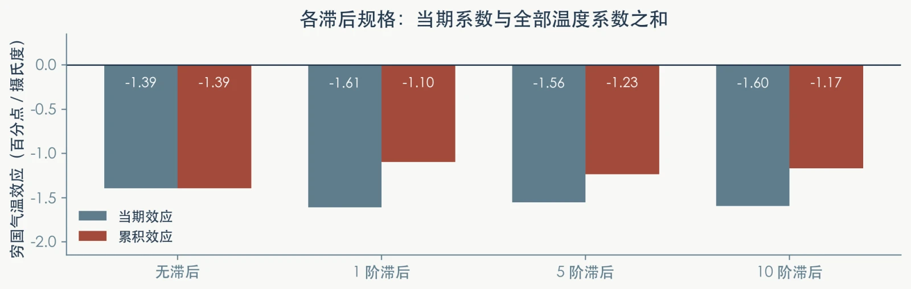

# 第6讲 代码和结果分析

> 本页与[案例实操](https://zhang-chenglei.github.io/Econometrics-course/course/lesson6_lab.html)逐项对应。全部参考数值来自实际运行；教学版使用 `reghdfe`，作者原包使用 `cgmreg`。先完成自己的分析，再对照本页。

## 文件与运行顺序

[下载课程代码与数据 ZIP](https://github.com/zhang-chenglei/Econometrics-course-materials/archive/refs/heads/main.zip)，进入 `lectures/lecture06_temperature_growth/`；[在线查看本讲代码目录](https://github.com/zhang-chenglei/Econometrics-course-materials/tree/main/lectures/lecture06_temperature_growth)。

| 文件 | 用途 |
|---|---|
| `run_case.py` | 教学、原包或两套流程的运行入口，检查完成标记与参考结果 |
| `scripts/install_dependencies.do` | 安装/核验 Stata 扩展命令 |
| `scripts/build_panel.do` | 按作者数据口径构造变量，估计阶梯、交互、趋势、标准误与滞后规格 |
| `scripts/build_numbers.py` | 汇总结果；从实际基准样本计算国家数、年份与聚类数 |
| `scripts/generate_figures.py` | 生成 11 张教学图，其中水平与增长图是概念示意 |
| `scripts/run_original_replication.py` | 在临时副本中运行原包七张表、两幅图 |
| `original/` | 作者数据、代码与 README，运行中保持原样 |
| `reference/`、`output/` | 前者是参考结果，后者是同学新跑出的结果 |

```sh
python3 -m pip install -r scripts/requirements.txt
python3 run_case.py --mode teaching --install
python3 run_case.py --mode original
```

需要两个软件：Stata 完成估计，Python 完成运行组织与绘图。没有 Stata 时只能阅读参考结果，不能声称已完成估计复现。依赖版本与字体要求见包内 README。

## 数据构造与单位

核心增长变量按作者口径构造：

```stata
encode fips60_06, gen(cc_num)
encode parent, gen(parent_num)
tsset cc_num year
gen lngdpwdi = ln(gdpLCU)
gen g = (lngdpwdi - L.lngdpwdi) * 100
```

限定至 2003 年，并要求每国至少有 20 年非缺失增长观测。初始收入分组按作者代码中的国家初值与中位数构造；地区×年份和穷国×年份编号在运行前生成。原始文件没有后续回归用的所有变量，因此不能跳过构建步骤。

`g` 是近似年度增长率。温度系数 −1.394 的单位是**增长率百分点/摄氏度**，不是“GDP 水平下降 1.394%”。它的经济解释仍依赖模型和识别假设。

完整构造面板为 **6,802 行、127 国、1950—2003 年**；教学基准 `e(sample)` 为 **4,909 行、126 个国家编号、1961—2003 年**，125 个 parent-country 和 243 个地区×年份聚类组。

## 任务1：固定效应阶梯

先运行完整教学入口。若在 Stata 中逐条查看，可进入案例目录运行 `do scripts/build_panel.do`（先建立 `output/data/`，或由入口自动创建）；脚本结束时保留构造后的数据。以下是对照规格：

```stata
reghdfe g wtem, noabsorb vce(cluster parent_num rynum)
reghdfe g wtem, absorb(cc_num) vce(cluster parent_num rynum)
reghdfe g wtem, absorb(cc_num year) vce(cluster parent_num rynum)
reghdfe g wtem, absorb(cc_num rynum) vce(cluster parent_num rynum)
reghdfe g wtem, absorb(cc_num rynum poorid) vce(cluster parent_num rynum)
```

| 规格 | 温度系数 | SE | p | N |
|---|---:|---:|---:|---:|
| 混合回归 | −0.10565 | 0.02053 | 0.000001 | 4,967 |
| 国家固定效应 | −0.57356 | 0.23878 | 0.017774 | 4,967 |
| 国家＋年份 | −0.30364 | 0.24464 | 0.216878 | 4,967 |
| 国家＋地区×年份 | −0.32275 | 0.26728 | 0.229508 | 4,952 |
| 国家＋地区×年份＋穷国×年份 | −0.32541 | 0.27019 | 0.230731 | 4,909 |

第一步混合了跨国、跨年信息；国家固定效应移除国家长期差异；年份及交叉固定效应进一步吸收共同变化。第四步删掉 15 个单例，第五步另有 43 行收入分组缺失。**这不是严格固定样本下的纯粹控制变量比较。** 本讲保留作者式递进流程并明确报告 N，不用擅自换样本的方式制造“更整齐”的表。

## 任务2：同一模型，四种标准误

```stata
reghdfe g wtem wtem_poor, absorb(cc_num rynum poorid)
reghdfe g wtem wtem_poor, absorb(cc_num rynum poorid) vce(robust)
reghdfe g wtem wtem_poor, absorb(cc_num rynum poorid) vce(cluster parent_num)
reghdfe g wtem wtem_poor, absorb(cc_num rynum poorid) vce(cluster parent_num rynum)
```

下面报告的是 `wtem_poor`，即**穷国相对富国的额外效应**：

| 推断方法 | 系数 | SE | t | p | N |
|---|---:|---:|---:|---:|---:|
| 常规 | −1.65514 | 0.41529 | −3.9855 | 0.000068 | 4,909 |
| robust | −1.65514 | 0.44150 | −3.7489 | 0.000180 | 4,909 |
| parent-country 聚类 | −1.65514 | 0.44912 | −3.6853 | 0.000340 | 4,909 |
| 双向聚类 | −1.65514 | 0.46259 | −3.5780 | 0.000495 | 4,909 |

系数和样本相同，变化的是不确定性。不能说“聚类使温度效应更小”。残差图按 `cc_num` 与相隔恰好 k 个日历年的记录配对；一阶相关约 0.194。图形误差条使用 `b ± 1.96×SE` 近似，表中 p 值来自 Stata，不由图形误差条代算。

## 任务3A：穷国与富国的斜率

```stata
reghdfe g wtem wtem_poor, absorb(cc_num rynum poorid) ///
    vce(cluster parent_num rynum)
lincom wtem
lincom wtem_poor
lincom wtem + wtem_poor
test wtem_poor = 0
```

| 对象 | 系数 | SE | p |
|---|---:|---:|---:|
| 富国效应 `wtem` | 0.26094 | 0.29598 | 0.379690 |
| 穷国额外效应 `wtem_poor` | −1.65514 | 0.46259 | 0.000495 |
| 穷国总效应 `poor_net` | −1.39420 | 0.38908 | 0.000486 |

总效应为两个系数之和，但其方差还包含协方差：

$$\operatorname{Var}(\hat\beta_1+\hat\beta_2)=\operatorname{Var}(\hat\beta_1)+\operatorname{Var}(\hat\beta_2)+2\operatorname{Cov}(\hat\beta_1,\hat\beta_2).$$

因此总效应 SE 不能用 0.29598＋0.46259 计算。`test wtem_poor=0` 检验组间斜率差异；同一估计与推断口径下的一维检验与该系数的双侧检验对应。富国未显著不等于“富国效应为零”。

## 任务3B：国家特定趋势

```stata
reghdfe g wtem wtem_poor, ///
    absorb(cc_num cc_num#c.year rynum poorid) ///
    vce(cluster parent_num rynum)
lincom wtem + wtem_poor
```

| 穷国总效应 | 系数 | SE | p | N |
|---|---:|---:|---:|---:|
| 不加国家趋势 | −1.39420 | 0.38908 | 0.000486 | 4,909 |
| 加国家线性趋势 | −1.74201 | 0.45813 | 0.000224 | 4,909 |

两行 N 相同，但用来识别的变化不同。增加趋势后净效应更负、SE更大；它可能是控制趋势后的比较，也可能损失低频信息。选择需要经济背景，不能只看大小或星号。

## 任务3C：当期效应与全部滞后系数和

以一阶规格为例；实际构建脚本还估计五阶与十阶：

```stata
reghdfe g wtem_poor L1wtem_poor wtem_rich L1wtem_rich, ///
    absorb(cc_num rynum poorid) vce(cluster parent_num rynum)
lincom wtem_poor
lincom wtem_poor + L1wtem_poor
```

| 滞后阶数 | 穷国当期系数 | 穷国系数和 | 系数和 SE | 系数和 p | N |
|---|---:|---:|---:|---:|---:|
| 0 | −1.39420 | −1.39420 | 0.38908 | 0.000486 | 4,909 |
| 1 | −1.60961 | −1.09593 | 0.39859 | 0.006862 | 4,909 |
| 5 | −1.55510 | −1.23484 | 0.50205 | 0.015287 | 4,901 |
| 10 | −1.59656 | −1.17101 | 0.58255 | 0.046587 | 4,891 |

当期系数不等于累计水平影响；系数和的 SE 也要用完整协方差矩阵，由 `lincom` 计算。十阶富国系数和约 −0.15175，SE约0.75010，p约0.840，未显著异于零。

{fig-alt=""}

不同滞后规格的样本量不同。图 8 的单期误差条不提供系数和的置信区间；不能把它们逐期相加成累积置信带。一次冲击的有限滞后结束后增长率可恢复，系数和非零仍可留下水平缺口；持续升温是不同情形。

## 拓展任务4：论文原包与教学版对照

```sh
python3 run_case.py --mode original --install
```

原包入口核验九个完成步骤、预期文件非空与原始输入 SHA-256 未变。表 3、表 6 的 34 条旧 `outreg` 导出行在运行副本中改为 `outreg2`；样本、回归、聚类与检验不改。`reference/original/` 保存七张表、两幅图及核心数值核对表，新的原包结果位于 `output/original/日期_时间/`。

| 核心项目 | 原包 `cgmreg` | 教学 `reghdfe` |
|---|---:|---:|
| 富国温度效应（SE） | 0.261（0.312） | 0.261（0.296） |
| 穷国额外效应（SE） | −1.655（0.485） | −1.655（0.463） |
| 穷国总效应（SE） | −1.394（0.408） | −1.394（0.389） |
| 表2基准 N | 4,924 | 4,909 |
| 表3无降水十阶穷国系数和（SE） | −1.171（0.611） | −1.171（0.583） |
| 十阶系数和 p | 约 0.055 | 0.046587 |

原包十阶在 10% 水平显著，教学版在 5% 水平显著。点估计按三位小数吻合，不代表推断完全一致。单例处理、协方差修正与推断口径有差异，两套流程均出现非正半定协方差矩阵的修正提示，运行日志会保留它们。不能只用“自由度不同”解释全部差异。

本次核验包括全流程完成，以及包内 March 2012 稿表 2、表 3 的 19 项核心数字；没有逐格核验全部七张刊发表格。导出表可能包含现代 Stata 显示的省略固定效应行，不能把零占位行当作新的实质估计结果。

## 怎样写结果解释

一段可接受的解释应说清：在控制国家与组别年度共同变化后，比较来自同一国家温度的剩余变化；教学规格下穷国总效应约 −1.394 个增长率百分点/摄氏度，额外效应约 −1.655；推断按 parent-country 和地区×年份双向聚类；趋势、动态设定与样本处理影响结果。固定效应排除了指定的加性共同因素，仍需讨论时变遗漏、测量误差、收入分组与长期适应，因此不能把回归表自动写成确定的气候政策预测。

[返回本讲讲义](https://zhang-chenglei.github.io/Econometrics-course/course/ch04.html)｜[返回案例实操](https://zhang-chenglei.github.io/Econometrics-course/course/lesson6_lab.html)
